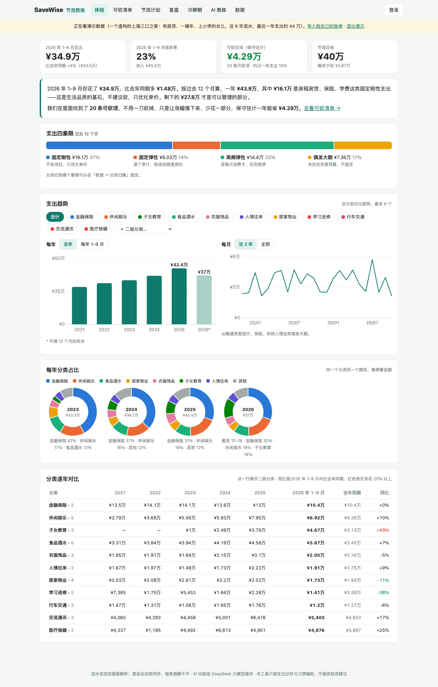
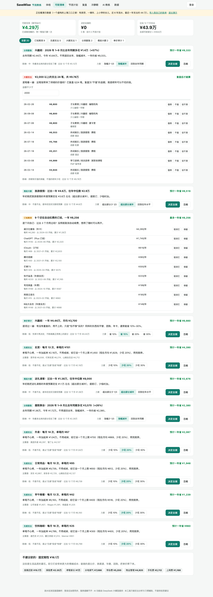
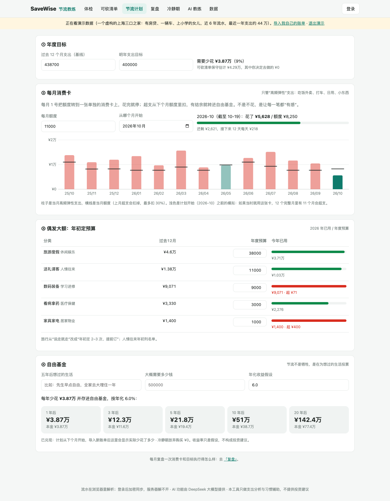
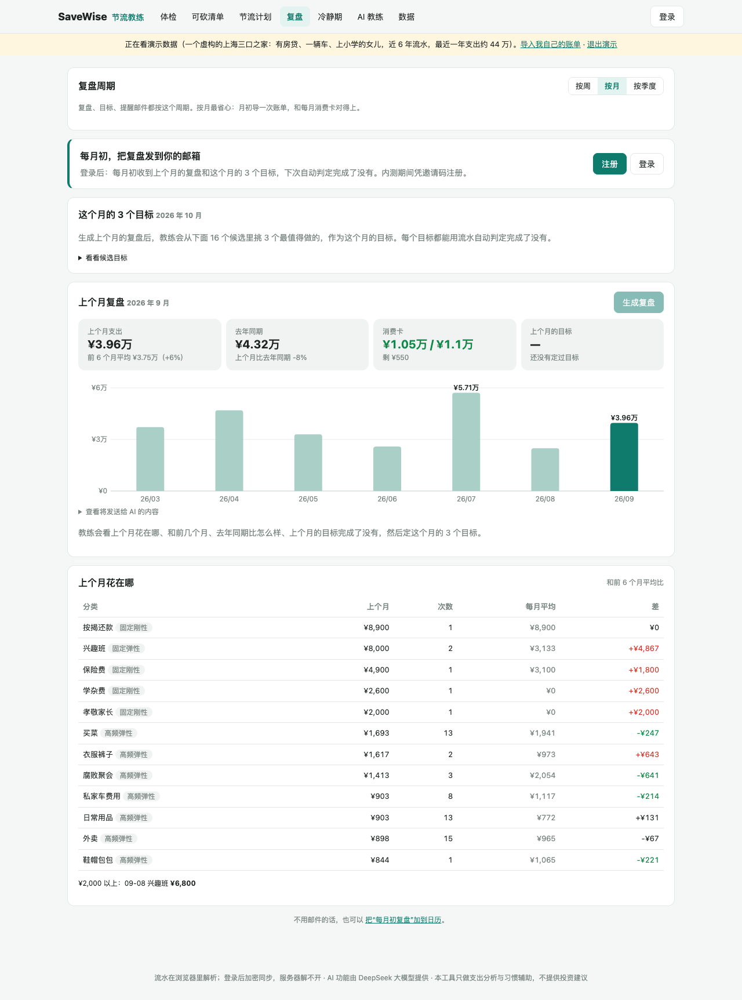
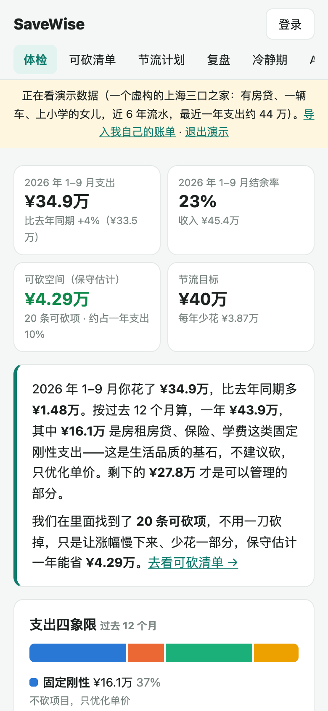

# SaveWise 节流教练

> 别再凭感觉砍，让你的流水告诉你钱漏在哪。

SaveWise 不是又一个记账 App。它的用法是：

1. 把随手记、微信支付、支付宝的账单导进来。
2. 它找出**无感的小额高频**、**还在扣钱的订阅**、**不值的大额支出**和**悄悄膨胀的分类**，算出每一项一年能省多少。
3. 再陪你把节流变成**每月一张消费卡**，省下的钱放进为“几年后想过的生活”准备的**自由基金**。
4. **每月初**（也可以选按周、按季度）提醒你复盘：上个月花在哪、目标完成了没有，再定这个月的 3 个目标。目标都能用流水自动判定。

**流水在你的浏览器里解析。登录后先在浏览器里加密再同步，服务器只存密文，解不开；服务器上没有任何明文的流水、汇总或复盘，提醒邮件不含金额。** 产品里的「隐私」页用大白话讲了这些，还有一本本机的「数据流向账」，记下这台设备发出去过的每一份数据。

线上地址：https://savewise.waywise.tech（内测中）　·　产品调研与形态选择见 [docs/调研与决策.md](docs/调研与决策.md)



## 为什么做这个

一年花 70 多万，想降到 60 万。难的不是“记”，而是：

1. **看完数据不知道砍哪。** 报表只告诉你餐饮花了多少，不告诉你哪一块能砍、砍了会不会影响生活。
2. **砍错地方。** 凭感觉砍，最先被砍的往往是房租、阿姨、孩子这些“看起来贵”但其实是生活品质基石的支出。真正该砍的是无感的小额高频、忘了取消的会员和焦虑时下的单。
3. **月底又超支。** 没有一个简单的机制，把“年度目标”变成“这个月还能花多少”。
4. **问 AI 只得到正确的废话。** 把账单丢给聊天机器人，得到的是“控制购物类支出，可省 20–30%”。算不准，也落不了地。

所以 SaveWise 的原则是：

- **做决策，不做记账**：你已经记了好几年账，不用再记一遍。
- **规则算数，AI 说话**：每一项可省金额都由确定性规则算出，能追溯到具体交易。AI 只负责解释、排序、出主意，不编数字。
- **不砍生活品质**：固定刚性支出不建议砍，只优化单价。
- **每月一个小闭环**：一年的目标太远。每月 3 个能自动判定的目标，下个月看结果、再定下一个月；复盘、目标、消费卡都按同一个周期（也可以改成按周或按季度）。
- **不一刀砍掉**：决定去做的可砍项可以选力度——少花一两成、让涨幅减半，而不是退回去年。
- **服务器零明文**：不登录也能用全部分析，数据只在本机。登录后，流水、计划、复盘都用你的密码在浏览器里加密再同步，服务器没有密钥。AI 只在你点按钮时收到按月、按分类的汇总，服务器转发后不保存；发送前能看到完整内容，发过的都记在本机的数据流向账里。

## 功能

| 页面 | 做什么 |
|---|---|
| **体检** | 今年 1 月到最近一个完整月的支出、结余率，对比去年同期（日历年，不是“近 12 个月 vs 前 12 个月”）。四象限：固定刚性 / 固定弹性 / 高频弹性 / 偶发大额。支出趋势：每年、每月，可以选几个一级或二级分类对比，每年可以只看“1–N 月同期”。每年分类占比环形图。分类逐年对比，同比涨 20% 以上的标红 |
| **可砍清单** | 六类规则，按“一年能省多少”排序，每条都可以选“决定去做”或“忽略”（规则见下表）。合计时同一笔钱只算一次 |
| **节流计划** | ① 年度目标。② 每月消费卡：只管高频弹性支出，超支扣下月（最多扣 30%），结余进自由基金，计划开始前按过去 12 个月模拟。③ 偶发大额的年度预算和今年已用。④ 自由基金：按年化假设复利，算出“几年能攒够想过的生活” |
| **复盘** | 按月（默认）、按周或按季度。上一期花了多少、和前几期平均比、和去年同期比（按月、按季度）、消费卡额度、上一期的 3 个目标完成了没有。AI 从规则算出的候选目标里挑 3 个作为这一期的目标（比如“外卖这个月不超过 ¥700”“饮料咖啡不超过 12 次”），进行中就能看到进度。复盘在浏览器里生成后加密同步，服务器不保存。登录后每期初早上 8 点发一封提醒邮件（不含金额）；想要邮件版的复盘，点「发到我的邮箱」发一次，发完不保存 |
| **冷静期** | 想买的大件先放 72 小时，记下当时的状态（焦虑、疲惫、冲动），到期再决定；放弃购买的钱计入自由基金 |
| **AI 教练** | 直接问，比如“今年哪里花得比去年同期多”“外卖比去年多了多少”（定期复盘在「复盘」页） |
| **数据** | 已导入的文件、流水明细查询、未分类商户（关键词归类，或交给 AI 归类）、分类归属（四象限）、账号（同步状态、提醒邮件开关、改密码、注销）、导出备份 / 恢复 / 清空 |

可砍清单的六类规则：

| 类型 | 规则 | 建议 |
|---|---|---|
| 订阅黑洞 | 同一商户按月或按年固定扣款，最近还在扣 | 逐个决定取消还是保留 |
| 无感支出 | 单笔中位数 ≤ ¥200、每月 ≥ 8 次 | 设月上限 |
| 大额支出 | 固定刚性之外、单笔 ≥ ¥2000（可以改），按金额列出 | 逐笔复盘“值不值”，不值的算可省 |
| 分类膨胀 | 今年同期比去年同期 +20% 且折合一年多花 ≥ ¥3000 | 默认涨幅减半，可选少 1/3 或回到去年同期 |
| 偶发大额 | 超出往年中位数 | 年初定预算 |
| 单价审计 | 保健品、早教这类固定弹性，每年 ≥ ¥1 万 | 比价、找平替 |

<table>
<tr>
<td width="50%"><br><sub><b>可砍清单</b>：订阅、无感支出、大额支出复盘</sub></td>
<td width="50%"><br><sub><b>节流计划</b>：消费卡、偶发预算、自由基金</sub></td>
</tr>
<tr>
<td><br><sub><b>复盘</b>：按月复盘与这个月的 3 个目标</sub></td>
<td align="center"><br><sub><b>手机端</b>：可添加到桌面（PWA）</sub></td>
</tr>
</table>

### 支持导入

| 来源 | 怎么导出 | 解析要点 |
|---|---|---|
| 随手记 | 网页版「导入导出 → 数据导出」，或 App 导出（需会员） | 多个工作表（支出 / 收入 / 转账），保留你自己的分类 |
| 微信支付 | 我 → 服务 → 钱包 → 账单 → 常见问题 → 下载账单，每次最多 3 个月 | 加密 zip 可以直接拖进来，在浏览器里输入密码解开。跳过前面的说明行。全额退款不算，部分退款扣掉退回的部分，零钱提现等算转账。没有分类的按商户关键词归类 |
| 支付宝 | 我的 → 账单 → ··· → 开具交易流水证明，每次最多 1 年 | GBK 编码，“不计收支”算转账，“交易关闭”跳过 |
| 其他 App / 银行流水 | 任何有“日期”和“金额”列的 CSV / Excel | 负数当支出，或“支出金额 / 收入金额”分两列 |

导入随手记的同时又导入微信、支付宝时，会检查两边时间重叠的部分。如果大量支出“同一天、同金额”，会提示可能重复计算。

## 怎么实现的

```
浏览器                                                    服务器
┌──────────────────────────────────────────────┐        ┌────────────────────────────────┐
│ files.js   zip 解密（zip.js）/ Excel（SheetJS） │        │ FastAPI                        │
│ parse.js   识别来源、找表头、退款/转账、去重      │  密文  │  /api/vault   加密同步（乐观锁）  │
│ categorize 商户关键词 → 统一分类、四象限           ├───────►│  /api/register /login 账号      │
│ analyze.js 体检、六类可砍规则、合计去重          │        │  /api/recaps  转给 AI，不保存    │
│ plan.js    目标、消费卡、偶发预算、自由基金        │  汇总  │  /api/ai/*    复盘、问答、归类   │
│ review.js  周/月/季汇总、目标候选、自动判定       ├───────►│ 每天 08:00 按各人周期发提醒邮件   │
│ account.js 密码派生密钥、压缩加密、合并            │        │ SQLite：账号、密文、调用记账     │
│ store.js   IndexedDB                          │        └───────────────┬────────────────┘
└──────────────────────────────────────────────┘                        ▼ DeepSeek / SMTP
```

- **前端**：原生 JS（ES modules），不需要构建，不依赖外部 CDN。两个第三方库放在 `static/vendor`，用到时才加载：SheetJS 0.20.3（Excel）和 zip.js 2.7（加密 zip）。图表是自己画的 SVG，支持深色模式。PWA 可以离线打开。
- **账号与加密同步**（参考 Bitwarden 的做法）：
  - 浏览器用 PBKDF2 从密码派生两把钥匙：登录口令（发给服务器，服务器再加盐哈希）和数据密钥（AES-GCM，只存在浏览器的 IndexedDB 里）。服务器拿不到密码，也就解不开数据。
  - 同步的内容是流水、计划、可砍项的选择、复盘和目标、冷静期、AI 问答记录，先 gzip 再加密，整份上传。用版本号做乐观锁：别的设备先改过，就先下载合并（流水按交易 ID 去重，本机优先）再上传。
  - 代价：忘了密码只能重设，云端密文会清空，需要在存有数据的设备上登录一次重新上传。
- **后端**：Python FastAPI。提供静态页面、账号、密文存储、复盘提醒（APScheduler 定时任务，每天 08:00，按每个用户选的周期，上一期过完就发一封不含金额的提醒）、AI 代理。
  - **成本控制**：全站每日预算、每个用户每天的调用次数、注册邀请码（内测）。
  - **服务器上没有明文的支出数据**：
    - 云同步只存密文（流水、计划、复盘、AI 问答记录都在里面）。
    - AI 接口只接受最多 4 万字的汇总（按周、按月、按分类），用户同意后才发；服务器转给 DeepSeek 后不保存，只记次数和成本。
    - 以前版本存在服务器上的复盘快照已删除；旧的复盘在用户下次登录时移进加密数据，然后从服务器删掉。
    - 「数据流向账」（`outbox.js`）：每次往服务器发数据，在本机记下原文，用户可以在「隐私」页翻看。
    - 设置了 CSP：页面只能连本站，脚本不可能把流水发到别的域名。
- **每期目标**：由 `review.js` 的规则生成候选（消费卡这一期的额度、无感支出的上限和次数上限、少买大件、取消订阅等一次性动作），AI 只能从候选里挑，服务器会校验 ID。下一期用流水自动判定完成了没有。
- **AI**：DeepSeek（OpenAI 兼容接口）。
  - 提示词在 [`app/prompts.py`](app/prompts.py)，规定了节流原则：不砍固定刚性、只用给定的数据、建议要能当周执行、不推荐理财产品。
  - 发给 AI 的内容由 [`static/js/ai.js`](static/js/ai.js) 生成，在页面上点「查看将发送给 AI 的内容」可以看到。

## 本地运行

```bash
python3 -m venv .venv
.venv/bin/pip install -r requirements.txt
cp .env.example .env        # 填 DEEPSEEK_API_KEY（不填也能用，只是没有 AI 教练）
.venv/bin/uvicorn app.main:app --port 8000
```

打开 http://127.0.0.1:8000 ，点「先看演示数据」，或者把自己的账单拖进去。

测试（解析器、分析引擎、定期复盘、加密与合并，需要 Node 20+）：

```bash
node tests/make_fixtures.mjs          # 用演示数据生成微信 / 支付宝 / 随手记格式的测试文件（含加密 zip）
node --test tests/*.test.mjs
```

| 变量 | 用途 |
|---|---|
| `DEEPSEEK_API_KEY` | AI 教练（复盘、问答、归类） |
| `INVITE_CODE` | 注册邀请码（内测），留空表示开放注册 |
| `DAILY_BUDGET_YUAN` / `USER_DAILY_CALLS` | 全站每日 AI 预算 / 每个用户每天的次数 |
| `SMTP_HOST` / `SMTP_USER` / `SMTP_PASSWORD` | 发复盘提醒、「发到我的邮箱」和找回密码 |
| `WEEKLY_RUN_TIME` | 每天几点跑定时复盘，默认 08:00 |
| `MODEL_DISCLOSURE` | 页面底部公示的模型和登记信息 |
| `ADMIN_EMAILS` | 这些邮箱注册后自动成为管理员，登录后在「数据 → 账号」里进后台（`/admin`） |
| `ADMIN_TOKEN` | 可选，脚本用：请求头 `X-Admin-Token` 带上它就能调 `/api/admin/*`，例如 `POST /api/admin/weekly-run` 补跑定时复盘 |

### 后台

`/admin`，只有管理员能打开（其他人看到的是 404）。只看账号和用量，看不到任何人的流水。

- **概览**：今日 AI 预算、DeepSeek 余额、用户数 / 活跃 / 云同步 / 提醒邮件人数、近 7 天按功能和近 14 天按日的调用与成本。
- **用户**：注册和最近访问时间、云同步大小、AI 用量；设为管理员、停用（立即踢下线）、发重设密码邮件（密码只有用户自己知道，管理员不能代设）。
- **复盘提醒**：每日提醒任务最近一次的结果、订阅用户的周期、本期已提醒人数、服务器上待迁移的旧复盘数，可以手动补跑。

## 部署

和 investwise 一样：systemd + Caddy，端口 8200，域名 `savewise.waywise.tech`。

```bash
DEPLOY_HOST=ubuntu@<服务器IP> DEPLOY_KEY=~/.ssh/<你的密钥> deploy/deploy.sh --setup --env .env   # 第一次
DEPLOY_HOST=ubuntu@<服务器IP> DEPLOY_KEY=~/.ssh/<你的密钥> deploy/deploy.sh                      # 以后每次
```

上线前要先把 `savewise.waywise.tech` 解析到服务器。

## 目录

```
app/          main.py 接口与安全头 · admin.py 后台接口 · auth.py 账号 · review.py 复盘（转给 AI）与提醒邮件 · notify.py 发邮件
              prompts.py 提示词 · llm.py DeepSeek 调用 · costs.py 预算与限次 · db.py 表结构
static/       index.html · admin.html 后台 · style.css · sw.js（离线）· manifest
static/js/    app.js 界面 · parse.js / files.js 导入 · categorize.js 分类与四象限 · analyze.js 体检与可砍规则
              plan.js 计划 · review.js 定期复盘 · account.js 加密同步 · ai.js 汇总与 AI 调用 · outbox.js 数据流向账
              charts.js 图表 · store.js 本地存储 · demo.js 演示数据 · admin.js 后台
tests/        make_fixtures.mjs 生成测试文件 · engine.test.mjs 解析与分析 · review.test.mjs 定期复盘与加密同步
deploy/       部署脚本、systemd、Caddy、备份
docs/         调研与决策、截图
```

## 路线图

- [ ] 用真实的随手记、微信导出文件校验列名（现在用模拟文件测试）
- [ ] 订阅“取消指引”：常见会员的退订路径
- [ ] 家庭共享：两个人各自导入，合并看（在现有加密同步上加共享密钥）
- [ ] 每期目标的完成率统计：哪类目标最容易坚持
- [ ] 轻量小程序：本月消费卡余额、冷静期到期提醒
- [ ] 和 InvestWise 打通：自由基金的去向

## 免责声明

本工具只做支出分析与习惯辅助。可省金额是按规则估算的，不保证实际效果；自由基金的收益率只是假设，不构成投资建议。
