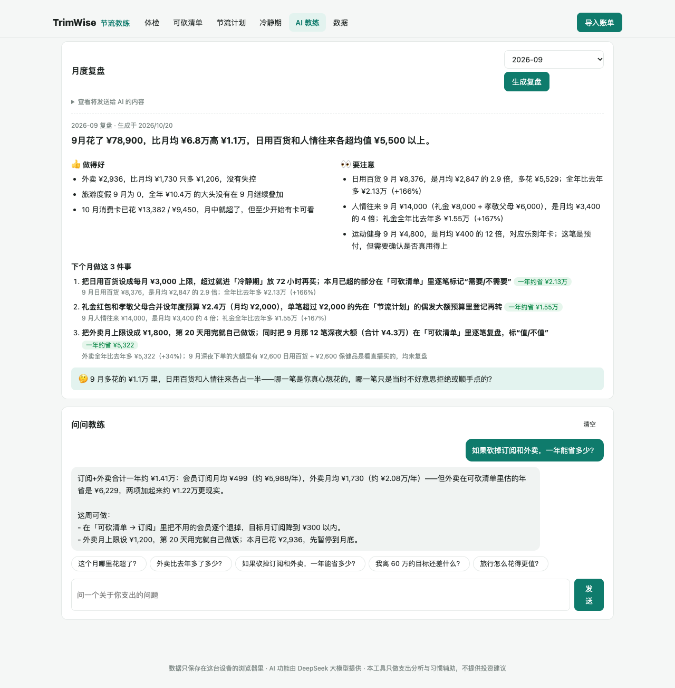

# TrimWise 节流教练

> 别再凭感觉砍，让你的流水告诉你钱漏在哪。

TrimWise 不是又一个记账 App。它的用法是：

1. 把随手记、微信支付、支付宝的账单导进来。
2. 它找出**无感的小额高频**、**还在扣钱的订阅**、**深夜冲动的大额消费**和**悄悄膨胀的分类**，算出每一项一年能省多少。
3. 再陪你把节流变成**每月一张消费卡**，省下的钱放进为“几年后想过的生活”准备的**自由基金**。

**流水只在你的浏览器里解析和保存，不上传服务器。**

线上地址（计划）：https://trimwise.waywise.tech　·　产品调研与形态选择见 [docs/调研与决策.md](docs/调研与决策.md)


## 为什么做这个

一年花 70 多万，想降到 60 万。难的不是“记”，而是：

1. **看完数据不知道砍哪。** 报表只告诉你餐饮花了多少，不告诉你哪一块能砍、砍了会不会影响生活。
2. **砍错地方。** 凭感觉砍，最先被砍的往往是房租、阿姨、孩子这些“看起来贵”但其实是生活品质基石的支出。真正该砍的是无感的小额高频、忘了取消的会员和焦虑时下的单。
3. **月底又超支。** 没有一个简单的机制，把“年度目标”变成“这个月还能花多少”。
4. **问 AI 只得到正确的废话。** 把账单丢给聊天机器人，得到的是“控制购物类支出，可省 20–30%”。算不准，也落不了地。

所以 TrimWise 的原则是：

- **做决策，不做记账**：你已经记了好几年账，不用再记一遍。
- **规则算数，AI 说话**：每一项可省金额都由确定性规则算出，能追溯到具体交易。AI 只负责解释、排序、出主意，不编数字。
- **不砍生活品质**：固定刚性支出不建议砍，只优化单价。
- **本地优先**：没有账号，流水不出浏览器。AI 只收到按月、按分类的汇总，发送前你可以看到完整内容。

## 功能

| 页面 | 做什么 |
|---|---|
| **体检** | 过去 12 个月的支出、结余率、可砍空间。四象限：固定刚性 / 固定弹性 / 高频弹性 / 偶发大额。每年、每月趋势。分类逐年对比，涨幅超过 20% 的标红 |
| **可砍清单** | 六类规则，按“一年能省多少”排序，每条都可以选“决定去做”或“忽略”（规则见下表）。合计时同一笔钱只算一次 |
| **节流计划** | ① 年度目标。② 每月消费卡：只管高频弹性支出，超支扣下月（最多扣 30%），结余进自由基金，计划开始前按过去 12 个月模拟。③ 偶发大额的年度预算和今年已用。④ 自由基金：按年化假设复利，算出“几年能攒够想过的生活”。⑤ 每月 1 号的复盘日历提醒（.ics） |
| **冷静期** | 想买的大件先放 72 小时，记下当时的状态（焦虑、疲惫、冲动），到期再决定；放弃购买的钱计入自由基金 |
| **AI 教练** | 月度复盘：做得好的、要注意的、下个月做的 3 件事、一个值得想的问题。也可以直接问，比如“这个月哪里花超了”“外卖比去年多了多少” |
| **数据** | 已导入的文件、流水明细查询、未分类商户（关键词归类，或交给 AI 归类）、分类归属（四象限）、导出备份 / 恢复 / 清空 |

可砍清单的六类规则：

| 类型 | 规则 | 建议 |
|---|---|---|
| 订阅黑洞 | 同一商户按月或按年固定扣款，最近还在扣 | 逐个决定取消还是保留 |
| 无感支出 | 单笔中位数 ≤ ¥200、每月 ≥ 8 次 | 设月上限 |
| 冲动大额 | ≥ ¥2000，标出深夜下单、备注里的情绪词、大促 | 逐笔复盘“值不值” |
| 分类膨胀 | 同比 +20% 且多花 ≥ ¥3000 | 回到前一年的水平 |
| 偶发大额 | 超出往年中位数 | 年初定预算 |
| 单价审计 | 保健品、早教这类固定弹性，每年 ≥ ¥1 万 | 比价、找平替 |

<table>
<tr>
<td width="50%"><br><sub><b>可砍清单</b>：订阅、无感支出、冲动复盘</sub></td>
<td width="50%"><br><sub><b>节流计划</b>：消费卡、偶发预算、自由基金</sub></td>
</tr>
<tr>
<td><br><sub><b>AI 教练</b>：月度复盘与提问</sub></td>
<td align="center"><br><sub><b>手机端</b>：可添加到桌面（PWA）</sub></td>
</tr>
</table>

### 支持导入

| 来源 | 怎么导出 | 解析要点 |
|---|---|---|
| 随手记 | 网页版「导入导出 → 数据导出」，或 App 导出（需会员） | 多个工作表（支出 / 收入 / 转账），保留你自己的分类 |
| 微信支付 | 我 → 服务 → 钱包 → 账单 → 常见问题 → 下载账单，每次最多 3 个月 | 加密 zip 可以直接拖进来，在浏览器里输入密码解开。跳过前面的说明行。全额退款不算，部分退款扣掉退回的部分，零钱提现等算转账。没有分类的按商户关键词归类 |
| 支付宝 | 我的 → 账单 → ··· → 开具交易流水证明，每次最多 1 年 | GBK 编码，“不计收支”算转账，“交易关闭”跳过 |
| 其他 App / 银行流水 | 任何有“日期”和“金额”列的 CSV / Excel | 负数当支出，或“支出金额 / 收入金额”分两列 |

导入随手记的同时又导入微信、支付宝时，会检查两边时间重叠的部分。如果大量支出“同一天、同金额”，会提示可能重复计算。

## 怎么实现的

```
浏览器（全部本地）                                         服务器（只做 AI 代理）
┌──────────────────────────────────────────────┐        ┌──────────────────────────┐
│ files.js   zip 解密（zip.js）/ Excel（SheetJS） │        │ FastAPI                  │
│ parse.js   识别来源、找表头、退款/转账、去重      │        │  /api/ai/review   复盘    │
│ categorize 商户关键词 → 统一分类、四象限           │  汇总  │  /api/ai/chat     问答    │
│ analyze.js 体检、六类可砍规则、合计去重          ├───────►│  /api/ai/classify 归类    │
│ plan.js    目标、消费卡、偶发预算、自由基金        │        │ 预算 / 每设备限次 / 记账   │
│ store.js   IndexedDB                          │        │ SQLite 只存调用记账        │
└──────────────────────────────────────────────┘        └────────────┬─────────────┘
                                                                     ▼ DeepSeek
```

- **前端**：原生 JS（ES modules），不需要构建，不依赖外部 CDN。两个第三方库放在 `static/vendor`，用到时才加载：SheetJS 0.20.3（Excel）和 zip.js 2.7（加密 zip）。图表是自己画的 SVG，支持深色模式。PWA 可以离线打开。
- **后端**：Python FastAPI，只做两件事，一是提供静态页面，二是代理 AI 调用。
  - **成本控制**：全站每日预算、每台设备每天的调用次数、可选的内测访问码。
  - **服务器不收原始流水**：
    - 接口只接受最多 4 万字的汇总。
    - 设备 ID 只存哈希。
    - 设置了 CSP：页面只能连本站，脚本不可能把流水发到别的域名。
- **AI**：DeepSeek（OpenAI 兼容接口）。
  - 提示词在 [`app/prompts.py`](app/prompts.py)，规定了节流原则：不砍固定刚性、只用给定的数据、建议要能当周执行、不推荐理财产品。
  - 发给 AI 的内容由 [`static/js/ai.js`](static/js/ai.js) 生成，在页面上点「查看将发送给 AI 的内容」可以看到。

## 本地运行

```bash
python3 -m venv .venv
.venv/bin/pip install -r requirements.txt
cp .env.example .env        # 填 DEEPSEEK_API_KEY（不填也能用，只是没有 AI 教练）
.venv/bin/uvicorn app.main:app --port 8000
```

打开 http://127.0.0.1:8000 ，点「先看演示数据」，或者把自己的账单拖进去。

测试（解析器和分析引擎，需要 Node 20+）：

```bash
node tests/make_fixtures.mjs          # 用演示数据生成微信 / 支付宝 / 随手记格式的测试文件（含加密 zip）
node --test tests/*.test.mjs
```

| 变量 | 用途 |
|---|---|
| `DEEPSEEK_API_KEY` | AI 教练（复盘、问答、归类） |
| `ACCESS_CODE` | 内测访问码，留空表示 AI 对所有人开放 |
| `DAILY_BUDGET_YUAN` / `DEVICE_DAILY_CALLS` | 全站每日 AI 预算 / 每台设备每天的次数 |
| `MODEL_DISCLOSURE` | 页面底部公示的模型和登记信息 |
| `ADMIN_TOKEN` | `/api/admin/stats?token=` 查看 AI 调用量和成本 |

## 部署

和 investwise 一样：systemd + Caddy，端口 8200，域名 `trimwise.waywise.tech`。

```bash
DEPLOY_HOST=ubuntu@<服务器IP> DEPLOY_KEY=~/.ssh/<你的密钥> deploy/deploy.sh --setup --env .env   # 第一次
DEPLOY_HOST=ubuntu@<服务器IP> DEPLOY_KEY=~/.ssh/<你的密钥> deploy/deploy.sh                      # 以后每次
```

上线前要先把 `trimwise.waywise.tech` 解析到服务器。

## 目录

```
app/          main.py 接口与安全头 · prompts.py 提示词 · llm.py DeepSeek 调用 · costs.py 预算与限次 · db.py 记账表
static/       index.html · style.css · sw.js（离线）· manifest
static/js/    app.js 界面 · parse.js / files.js 导入 · categorize.js 分类与四象限 · analyze.js 体检与可砍规则
              plan.js 计划 · ai.js 汇总与 AI 调用 · charts.js 图表 · store.js 本地存储 · demo.js 演示数据
tests/        make_fixtures.mjs 生成测试文件 · engine.test.mjs
deploy/       部署脚本、systemd、Caddy、备份
docs/         调研与决策、截图
```

## 路线图

- [ ] 用真实的随手记、微信导出文件校验列名（现在用模拟文件测试）
- [ ] 订阅“取消指引”：常见会员的退订路径
- [ ] 月度复盘邮件（可选，用户自己填邮箱）
- [ ] 家庭共享：两个人各自导入，合并看（需要可选的加密同步）
- [ ] 轻量小程序：本月消费卡余额、冷静期到期提醒
- [ ] 和 InvestWise 打通：自由基金的去向

## 免责声明

本工具只做支出分析与习惯辅助。可省金额是按规则估算的，不保证实际效果；自由基金的收益率只是假设，不构成投资建议。
